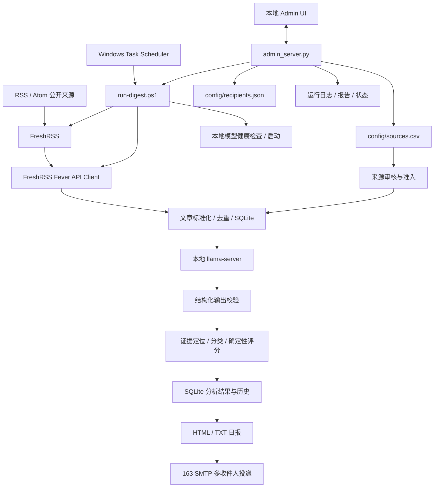

# Opportunity Radar：产品与工程综合审查报告

- 审查对象：用户上传的 `Opportunity-Radar-main(1).zip`
- 审查日期：2026-10-20
- 审查方式：静态阅读代码与文档；在解压副本中执行现有 Python 单元测试
- 测试结果：`python -m unittest discover -s tests -v`，140 tests passed
- 未完成：未连接用户本机 FreshRSS、llama-server、163 SMTP、Windows Task Scheduler；未进行在线 RSS URL / 条款的逐一验证；未进行真实浏览器矩阵或邮件客户端视觉验收
- 重要边界：这是一份产品与工程审查，不是正式法律意见或安全认证

## 1. 执行摘要

项目已达到“可继续个人使用、可公开展示工程设计”的 MVP 水平。当前技术路径合理：FreshRSS 负责订阅聚合，Python 负责确定性编排与验证，本地 LLM 负责结构化分析，SQLite 负责持久化，HTML/TXT 负责报告，SMTP 负责投递，Windows Task Scheduler 负责定时。

现阶段不建议为了技术时髦而立刻迁移到 React/FastAPI。先完善契约、错误处理、运行可观测性和端到端测试；把前端的单文件 HTML/CSS/JS 拆成静态资源即可。若未来需要复杂机会工作台、多用户权限、在线部署或团队协作，再引入 TypeScript + React/Vite，并将后端 API 服务化。

### 总体评价

| 领域 | 现状判断 | 下一步重点 |
|---|---|---|
| 产品定位 | 合适的个人机会情报 MVP | 明确“信号≠机会≠付费需求” |
| 数据管线 | 模块边界清楚 | 对运行阶段和失败结果统一建模 |
| LLM | 本地调用、结构化输出、规则评分 | 建立人工标注基准集与质量评估 |
| 数据存储 | SQLite 对单机规模合适 | 把运行、分析、投递状态做成可审计记录 |
| 管理 UI | 可用的单页原生 HTML | 拆分资源、改善无障碍、加载/错误/空状态 |
| API | 轻量标准库 HTTP 服务 | 统一错误格式、输入校验、接口契约测试 |
| 邮件 | 多收件人逐个投递 | 逐收件人投递结果、幂等和重试策略 |
| 安全 | 绑定 loopback，凭据放 `.env` | 加固本地管理接口、日志脱敏、秘密扫描 |
| 测试 | 140 项单元测试通过 | 集成、端到端、前端交互和故障测试 |
| 法律与来源 | 有来源登记与审核门槛 | 对每个来源做人工条款复核与数据最小化 |

## 2. 当前真实架构



### 数据和职责边界

- FreshRSS：管理订阅源和抓取；本项目通过 Fever API 读取，不应被描述为任意网站爬虫。
- `sources.csv`：本项目的来源准入登记表；FreshRSS 中存在某个 Feed，不代表本项目自动获准使用。
- 本地模型：提出结构化分析，不应拥有任意工具执行权，也不能被当作事实裁判。
- Python 规则层：验证输出结构、证据可定位性、分类和评分，是可重复的确定性逻辑。
- SQLite：记录文章、分析、运行与相关历史；报告不应成为唯一事实来源。
- 报告与邮件：面向阅读的输出副本；必须与结构化分析结果保持一致。
- Admin UI：当前是单机操作入口，不是具有用户认证、权限和远程部署能力的 SaaS 后台。

## 3. 代码阅读地图

| 阅读顺序 | 文件 | 需要理解的问题 |
|---|---|---|
| 1 | `opportunity_radar/cli.py` | 一次完整运行的入口、阶段顺序、失败如何处理 |
| 2 | `opportunity_radar/config.py` | `.env` 如何映射到运行配置、默认值和验证 |
| 3 | `opportunity_radar/freshrss_client.py` | 如何调用 Fever API、如何处理 HTTP/JSON 错误 |
| 4 | `opportunity_radar/source_policy.py`、`source_audit.py` | 来源准入、审核状态和审计规则 |
| 5 | `opportunity_radar/analyzer.py`、`schema.py` | Prompt、模型调用和结构化输出验证 |
| 6 | `opportunity_radar/classifier.py`、`scoring.py` | 确定性分类、证据与评分规则 |
| 7 | `opportunity_radar/store.py` | SQLite schema、迁移、运行记录与分析历史 |
| 8 | `opportunity_radar/digest.py`、`render_html.py` | 如何将结构化结果转为日报 |
| 9 | `opportunity_radar/email_sender.py` | SMTP 安全模式、多收件人投递 |
| 10 | `opportunity_radar/admin_server.py`、`admin/index.html` | 本地 API、页面交互和运维入口 |
| 11 | `deploy/windows/*.ps1` | 手动、定时、启动模型和服务的实际执行路径 |

## 4. 前端框架选型建议

### 当前阶段：暂不引入 React

理由：
1. 目前 UI 由单一用户在本机操作，页面规模有限。
2. 后端不需要公网部署，Python 标准库可减少安装、升级和运行时依赖。
3. 当前更大的风险是运行状态、错误反馈、测试和数据边界，而不是缺少前端框架。
4. 迁移 React 会新增 Node.js、构建脚本、依赖锁定、构建产物和前后端开发流程；这些成本现在未必产生相称收益。

### 现在应做的前端整理

- 将 `admin/index.html` 拆为 `admin/index.html`、`admin/assets/app.css`、`admin/assets/app.js`。
- 统一 API 调用函数与错误显示；避免每个按钮各自实现不一致的错误处理。
- 为页面增加 loading、empty、error、success 状态。
- 对所有危险操作增加确认；任务运行中禁用重复启动。
- Modal 支持 Escape、焦点进入与关闭后焦点恢复；表单输入提供可读 label 和错误关联。
- 为表格增加排序/分页（当来源、机会和历史记录数量需要时再实现）。
- 使用语义 HTML、键盘操作、足够的对比度和清晰焦点样式。
- 为前端增加最少一套自动化交互测试。

### 何时迁移到 TypeScript + React/Vite

满足以下任意两项时，启动前端重构评估：
- 出现多个复杂的工作台视图：机会列表、机会详情、人工复核、分析历史、图表。
- 组件和交互开始大量重复，原生 JS 难以保持状态一致。
- 需要较完整的前端自动化测试和类型契约。
- 需要将 UI 与 API 独立部署或为多个用户提供服务。

若迁移，建议先保留 Python 业务逻辑；前端 React/Vite 通过版本化 JSON API 调用后端。不要同时重写前端、API、数据库和调度系统。

### 后端框架选型

现在可继续使用标准库 HTTP Server，但应明确它是“本机单用户工具”。如果以后需要认证、中间件、OpenAPI、复杂请求验证、并发作业管理或公网部署，再考虑 FastAPI。不要只为了自动生成 Swagger 而迁移。

## 5. 优先级问题清单

### P0：在扩展功能前完成

1. **本地后台安全边界**：保持绑定 `127.0.0.1`；不要做局域网或公网端口映射。对所有 API 路由统一执行 Host/Origin 策略，不要只在写入接口做检查。对敏感操作使用明确的请求来源校验。
2. **端到端验收**：建立一份真实环境 smoke test，逐一验证 FreshRSS、模型、SQLite、报告、SMTP 和计划任务。
3. **邮件逐收件人结果**：目前 `send_email` 逐个发送；如果第 N 个地址失败，前面的可能已经收到，接口却只返回整体错误。应记录每个地址的成功/失败，并支持只重试失败地址。
4. **任务生命周期**：后台进程状态目前主要在内存变量中；服务重启后无法可靠还原任务状态。应以 SQLite 的 run 记录作为状态来源，并区分 queued/running/succeeded/partial_failed/failed。
5. **配置与路径一致性**：检查管理页面读取的报告路径与 `OR_REPORT_DIR` 是否一致；配置值、状态展示与运行脚本必须来自同一配置源。
6. **异常信息**：API 返回给 UI 的错误应简洁且可操作，详细堆栈写入本地日志；禁止记录 SMTP 授权码、API Key、完整认证头。
7. **来源条款核验**：候选源保持禁用，直到人工检查源所有者、Feed 提供方、条款、归属、保存期限和允许用途。

### P1：下一轮迭代

1. 将 HTML/CSS/JS 拆分，减少单文件耦合。
2. 加入统一 API 错误结构，例如 `{ "error": { "code": "...", "message": "...", "details": [] } }`。
3. 对每个写操作增加输入 schema、长度限制和错误字段定位。
4. 增加并发保护：来源 CSV 写入使用锁或原子事务，防止两个管理请求互相覆盖。
5. 运行日志轮转、保留期和下载/复制功能；日志展示默认脱敏。
6. 增加收件人单独测试、逐地址投递结果、发送记录和重试策略。
7. 增加前端交互测试与浏览器视觉验收。
8. 将定时任务的注册状态、最后执行时间、退出码显示在 UI 中，而不是只显示“注册成功”。

### P2：有数据后再做

- 机会详情和人工复核工作台。
- 评分解释、证据引用、未知项和下一步验证动作的统一展示。
- 按主题/来源/证据等级/商业阶段筛选与趋势分析。
- React/Vite 前端、FastAPI 后端或多用户权限。
- 云端部署、账户系统、在线订阅、团队协作。
- 用人工标注集做误报/漏报分析和评分回测。

## 6. 产品定义与核心交互

### 产品定位

Opportunity Radar 是“个人机会情报与验证工作台”，不是自动赚钱机器，也不是自动判定市场规模的预测系统。

### 核心用户任务

1. 配置并审核信息源。
2. 定时收集并分析文章。
3. 从日报中挑选值得验证的线索。
4. 查看原文和证据，区分事实、推断和未知。
5. 记录人工复核结果。
6. 用低成本实验验证问题频率、替代方案、买方和付费意愿。
7. 回看系统运行和投递是否成功。

### 机会详情必须回答

- 信号是什么？来源是谁？原始链接在哪里？
- 哪些句子是可定位的直接证据？
- 哪些是模型解释而非原文事实？
- 是否有明确付费/预算/采购信号？
- 哪些关键信息仍未知？
- 下一步最低成本验证是什么？
- 什么结果会让我们停止追踪这个机会？

## 7. API 契约建议

当前主要路由：

| 方法 | 路径 | 目的 | 风险/改进 |
|---|---|---|---|
| GET | `/api/status` | 本地模型、来源数、收件人、报告与运行状态 | 增加统一状态 schema 和计划任务状态 |
| GET | `/api/sources` | 获取来源登记 | 增加分页/字段 schema（规模变大时） |
| POST | `/api/sources/save` | 保存来源 | 校验字段、并发保护、审计事件 |
| GET | `/api/freshrss-feeds` | 获取本机 FreshRSS Feed 列表 | 认证失败需给出可操作错误 |
| GET | `/api/recipients` | 读取收件人 | 不应暴露给非本机页面 |
| POST | `/api/recipients/save` | 保存收件人 | 增加变更记录与地址格式错误定位 |
| POST | `/api/email/test` | 发送测试邮件 | 返回每个收件人的结果 |
| POST | `/api/run` | 启动日报 | 使用持久化任务 ID，防止重复启动 |
| POST | `/api/schedule` | 注册 Windows 计划任务 | 增加查看/更新/移除状态接口 |
| GET | `/api/logs` | 查看日志尾部 | 脱敏、分页、限制输出长度 |
| GET | `/report` | 打开最新 HTML 报告 | 确保报告内容已转义，且仅本机可访问 |
| POST | `/api/source-check` | 来源元数据/可达性审计 | 明确区分元数据错误与网络不可达 |

建议 API 统一返回：
```json
{
  "ok": false,
  "error": {
    "code": "SOURCE_VALIDATION_FAILED",
    "message": "启用来源未通过审计",
    "details": [
      {"field": "freshrss_feed_id", "message": "必须填写实际 Feed ID"}
    ]
  },
  "request_id": "local-generated-id"
}
```

## 8. 测试策略

### 当前测试结果

- 现有测试：140 项通过。
- 这是当前仓库已有单元测试结果，不代表在线依赖、Windows 调度、浏览器和邮件服务已通过。
- 当前明显需要补足：前端 DOM 交互测试、API 路由级集成测试、真实依赖 smoke test、故障恢复测试。

### 必须覆盖的测试层

1. 单元测试：来源策略、schema、评分、数据库迁移、收件人解析。
2. API 集成测试：HTTP 状态码、JSON schema、错误码、输入边界、并发写入。
3. 前端测试：保存来源、重复 ID、保存收件人、测试邮件失败、运行中禁用重复点击、空状态与错误提示。
4. 端到端 smoke test：FreshRSS API → 本地模型 → SQLite → HTML/TXT → SMTP。
5. 故障测试：模型超时、无有效 JSON、FreshRSS 不可达、SMTP 第 2 个收件人失败、数据库锁定、磁盘写入失败、Task Scheduler 失败。
6. 安全测试：不允许非本地 Host/Origin 写入；敏感字段不进入日志；页面输出转义；超大请求体被拒绝。
7. 兼容性测试：Windows PowerShell、当前支持的 Python 版本、主流桌面浏览器。

### 发布门槛

- 单元测试全部通过。
- API 契约测试全部通过。
- 无已知 P0 安全/数据丢失问题。
- smoke test 有人工签字记录。
- 报告、邮件和数据库结果一致。
- 测试中使用虚构数据与测试收件箱，不使用真实个人信息作为 fixture。

## 9. 来源质量治理

### 质量不是单一等级

应分开维护：
- 来源类型：官方、研究、媒体、社区、独立作者、厂商营销。
- 信号类型：原始用户痛点、产品发布、研究进展、融资/采购、竞品发布。
- 证据等级：可定位直接引文、二手报道、模型推断、未验证假设。
- 商业状态：未验证问题、重复痛点、存在替代方案、明确预算/付费、已付费试点。

### 候选来源的使用建议

- 官方一手源：用于确认产品、API、模型、软件和政策变动；不能独立证明用户需求。
- 原始研究：用于技术趋势与方法，不直接代表可售需求。
- 专业媒体：用于发现公司/市场信号，必须尽量回溯原始来源。
- Hacker News、开发者社区、CAE 论坛：用于发现问题与工作流摩擦；社区发帖不代表市场普遍性。
- 厂商博客：用于竞争情报与产品方向；需要标记营销立场。
- 第三方 RSS 桥接源：要同时核验原始平台规则与桥接服务规则。

当前 CSV 中的 URL/条款是候选登记值，本次审查没有逐一在线验证其可达性、当前内容或法律适用性。默认全部禁用是正确的安全姿势。

## 10. 法律、隐私和商业风险

- RSS 可访问不等于允许复制、长期存储、商业再发布或向第三方分发。
- 内部研究应优先保存必要元数据、短引文、原文链接和内容哈希；完整正文保存需要有明确的许可/用途/保留期限依据。
- 不要把文章全文、邮件地址、API Key、授权码、SQLite 数据库或日志推到公开 GitHub。
- 向其他人发送日报前，应明确接收者、发送频率、内容来源和退订/停止发送方式；如果将来变成公开服务，需要额外处理隐私政策、同意、删除、数据保留、反滥用和适用地区法规。
- 报告应标明“研究线索而非已验证商业机会”，不能把模型评分包装为投资、法律或商业成功保证。
- 如果部署为公开 SaaS，必须重新进行安全架构和法律审查；当前无认证的本地后台不得直接暴露到局域网或公网。

## 11. 推荐的 4 周执行计划

### 第 1 周：稳定性与契约
- 明确 API schema、错误码、运行状态。
- 修正邮件逐收件人投递结果和失败重试设计。
- 统一管理 UI 和 CLI 的配置来源。
- 补 API 集成测试与安全测试。

### 第 2 周：运维与真实验收
- FreshRSS、模型、数据库、报告、SMTP 做一次端到端 smoke test。
- 增加任务历史与定时任务状态。
- 增加日志脱敏、轮转和保留期限。
- 连续运行 3–7 天，记录成功率、耗时、失败类型。

### 第 3 周：体验与质量
- 拆分 HTML/CSS/JS。
- 加载/空/错误/成功状态、键盘操作和表单校验。
- 建立 50–100 条人工标注样本作为起始基准集；这只是工程起步集，不足以支持广泛准确率宣传。
- 对误报和漏报做人工复盘。

### 第 4 周：公开展示
- 用脱敏/虚构数据准备演示环境。
- 发布架构图、数据流图、API 契约、测试结果和已知限制。
- 展示一个成功案例和一个失败案例。
- 明确哪些功能真实运行，哪些是原型或未来规划。

## 12. 最终建议

下一轮不要重写整个技术栈。优先级建议：

1. 可靠运行与持久化任务状态；
2. API 错误契约与邮件投递可观测性；
3. 端到端与前端交互测试；
4. 管理 UI 的结构整理和可访问性；
5. 来源审核和证据质量；
6. 有真实使用数据后，再决定 React/Vite 或 FastAPI。

这条路线最符合当前“低成本、单机、本地模型、可公开分享”的项目目标。
