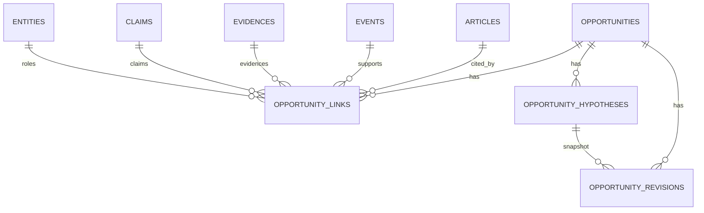

# Opportunity 数据模型设计与最小实现（P0 Batch 9–10）

> Batch 9 完成本设计；Batch 10 已在代码中实现 schema v9 的四张表、最小数据访问层、
> append-only trigger 和只读 audit。当前没有 Opportunity 数据行，也没有生产迁移。
> 生产库仍是 schema v5；隔离验证副本已迁移到 schema v9。

## 1. 范围与结论先行

本批次只回答三个问题：

1. 现有系统里有没有真正的 Opportunity 对象？
2. 如果没有，最小可追溯的 Opportunity 语义模型应该是什么？
3. 现有 65 个 B 通道文章级候选里，有多少能直接映射为机会、多少只能作为线索？

结论：

- Batch 10 已实现 Opportunity 的 schema 和最小数据访问；当前数据库中的 Opportunity 行数为 **0**。
  B 通道“值得验证的商业机会”仍是按文章分析、分类、评分和来源配额路由出来的文章级候选，
  不是自动创建的机会。
- 现有数据中，65 个 B 通道分析可以当作机会**种子**，但不能当作 65 个机会。
- 其中 42 个 B 事件有至少一条有效 Evidence，23 个 B 事件没有任何 Evidence。
- 170 条 B 通道 Claim 全部是 skeleton/unverified；没有任何 B Claim 可作为已核验事实。
- 只有 1 个 B 文章有实体 mention（2 条），64 个 B 候选没有实体关联，当前无法可靠识别买方。
- 0 个 B 事件有独立佐证；15 条 lineage 全部 declared，0 verified。
- 因此：现有数据可支持“有证据的线索”和“待验证线索”，但**不能自动形成已验证 Opportunity**。

## 2. 现有对象与真实调用链

### 2.1 数据对象

| 对象 | 实际存储 | 主键 / 唯一约束 | 证据可追溯性 |
|---|---|---|---|
| Article | `articles` | `article_key`（URL 内容哈希） | 有 URL、标题、发布时间、feed 标签、可选 `source_id`；正文不完整保存 |
| Source | `articles.source_id`、来源登记 CSV、`source_lineage.csv` | `source_id` | 摄取身份；`source_name` 是 feed 标签，不是 publisher |
| Analysis | `analyses`、`analysis_history`、`analysis_sections` | `article_key`；历史按 `article_key + analyzed_at` | `analysis_sections` 有 fact/inference/gap/action、状态、evidence_id、meta/locator |
| Event | `events`、`event_articles` | `event_id`；`event_id + article_key` | 事件本身没有事实正文；事实在 Evidence/Claim |
| Evidence | `evidences` | `evidence_id`（内容哈希） | 有 quote、locator、source_id、source_family、independence |
| Claim | `claims`、`claim_evidence` | `claim_id`；`claim_id + evidence_id` | 有 evidence link、locator、verification_state；当前 RSS Claim 全部 skeleton |
| Entity | `entities`、`entity_aliases`、`entity_mentions` | `entity_id`；mention_id | mention 有 article/evidence/claim 键、locator、method、confidence |
| Entity relation | `entity_relations` | `relation_id` | 当前验证副本为 0 行 |
| Event candidate | `event_links` | `link_id` | candidate 不是已合并事件 |
| B candidate | `analyses.result_json.scoring` + 运行时 `item` | 无独立主键 | 不是数据库对象；只能靠 `article_key` 和归档 items JSON 追溯 |

`analysis_sections` 的 facts/inferences 是模型生成的文本分析；它们不是数据库中的 Evidence 实体。只有 `evidences` 和 `claims` 是独立的证据/主张对象。

### 2.2 B 候选如何形成

实际调用链：

```text
cli.main
  -> FreshRSSClient.fetch_articles
  -> Store.save_article
  -> LocalAnalyzer.analyze
  -> classify() / derive_lane() / score_article()
  -> Store.save_analysis(result, scoring)
  -> cli.attach_event_context
  -> items
  -> digest.render_digest / render_html
```

`score_article()` 输出：

- `lane`（A/B/C）
- `status`（priority/watch/filtered）
- `classification`
- `evidence_state`
- `market_validation`
- `components`
- `score`

B 通道的“商业机会”只是 `lane == 'B'` 的文章级 item：

- `_shown()` 选 `priority` / `watch` 且未被 source cap defer 的条目；
- 日报把 B 条目放进“二、值得验证的商业机会”；
- 没有任何 Opportunity 表或 Opportunity 行；
- 没有“问题、买方、付费、缺口、验证”作为独立对象存储；
- 文章级 `analysis` 和 `event` 状态只是附加到 item 上。

`items.json` 保存运行时 item 快照，但 `analyses.result_json.scoring` 才是可重建 B 通道的持久数据。`items` 本身没有稳定主键。

## 3. 数据映射（schema v8 验证副本）

验证库：

```text
data/archive/p0-batch6-migration-validation-2026-11-03/opportunity_radar.sqlite3
```

### 3.1 全局计数

| 对象 | 数量 |
|---|---:|
| articles | 138 |
| analyses | 117 |
| unanalysed articles | 21 |
| events | 117 |
| evidences | 220 |
| claims | 220 |
| claims skeleton/unverified | 220 |
| entities | 24 |
| entity mentions | 52 |
| source_lineage rows | 15 declared / 0 verified |
| events with NO_EVIDENCE | 47 |
| events with EVIDENCE_BACKED | 70 |
| events with independent corroboration | 0 |

### 3.2 B 通道映射

| 项目 | 数量 |
|---|---:|
| B 通道分析 | 65 |
| B 当前进入日报（priority/watch） | 5（4 watch + 1 priority） |
| B filtered | 60 |
| B 事件带 Evidence | 42 |
| B 事件无 Evidence | 23 |
| B Evidence 行 | 170 |
| B Claim 行 | 170（全部 skeleton/unverified） |
| B 文章有实体 mention | 1 篇 / 2 条 |
| B 多文章事件 | 0 |
| B 独立佐证事件 | 0 |
| 可自动验证为 Opportunity | 0 |

B 事件证据状态：

```text
EVIDENCE_BACKED: 42
NO_EVIDENCE:     23
INSUFFICIENT_EVIDENCE: 0
```

B 事件来源族/独立性：

```text
source_family_count: 0 或 1
independence_status: UNKNOWN 或 INSUFFICIENT_DATA
独立佐证: 0
```

### 3.3 映射分层

| 层级 | 数量 | 解释 |
|---|---:|---|
| 可直接挂 Evidence 的 B 种子 | 42 | 有 1 条以上有效 Evidence；只能作为 `seed_signal` + `fact_basis` 候选 |
| 只能作为无证据线索的 B 种子 | 23 | NO_EVIDENCE；不得作为事实依据 |
| 未分析、无法形成 B/Event 的文章 | 21 | 没有分析，不能生成 Opportunity |
| 可直接验证为 Opportunity | 0 | 没有 verified Claim、买方证据、付费证据或独立来源 |
| 可自动建立多文章机会 | 0 | 没有多文章 B 事件；事件候选也没有合并 |

> 65 个 B 分析不是 65 个机会。它们是 65 个文章级发现信号。42 个可挂证据，23 个只有线索，0 个可自动验证。

### 3.4 不能可靠形成机会的原因

1. **没有显式的机会问题/需求字段**：`summary_zh`、`pain_point`、`commercial_signal` 是模型分析文本，不是经核验的机会主键。
2. **没有买方实体**：B 文章只有 1 篇有实体 mention；无法从现有实体层识别买方、采购方或受影响方。
3. **没有付费证据**：B 的 payment 字段只是分类器关键词结果；没有 Opportunity 级付费/预算验证。
4. **Claim 全部 skeleton/unverified**：170 条 B Claim 不能作为已核验事实；Evidence 只能支撑“文本说了什么”，不能自动支撑“这是市场需求”。
5. **没有独立来源**：15 条 lineage 全部 declared，0 verified；没有事件独立佐证。
6. **没有机会级历史**：B lane/status 会随分析重跑和评分规则变化；`analyses` 有历史，但没有 Opportunity revision。
7. **没有人工验证工作流**：当前不存在 Opportunity 行、确认/反驳记录或验证状态迁移。
8. **21 篇未分析文章没有 Event**：不能映射为任何机会。

## 4. Opportunity 最小语义模型

### 4.1 Opportunity

Opportunity 是一个**可追踪的商业问题/需求假设**，不是 Article，也不是 Event。

最小字段：

- `opportunity_id`
- `canonical_key`（唯一）
- `title`
- `problem_statement`
- `buyer_scope`
- `opportunity_kind`
- `stage`
- `validation_state`
- `confidence`
- `first_seen_at`
- `last_seen_at`
- `current_revision_id`
- `rules_version`
- `created_at`

一个 Opportunity 可以关联：

- 多篇 Article；
- 一个或多个 Event；
- 多条 Evidence；
- 多条 Claim；
- 多个 Entity；
- 多个观察时间和修订。

不默认一篇文章一个机会，也不默认一个 Event 一个机会。

### 4.2 Fact basis

Fact basis 是机会判断引用的事实依据，必须回到原始对象和定位。

角色：

| role | 含义 | 能否支撑事实 |
|---|---|---|
| `seed_signal` | B 通道文章分析/候选 | 否，只是发现信号 |
| `fact_basis` | 有来源、引文、定位的 Evidence，或已核验 Claim | 是，但只支撑它明确陈述的事实 |
| `unverified_claim` | skeleton / unverified Claim | 否，不能当作事实 |
| `inference` | `analysis_sections` 的 inference，带 basis 引用 | 否，是推断 |
| `counter_evidence` | 反驳依据 | 用于降级/否定，不作为支持 |
| `payment_evidence` | 直接付费/采购/预算 Evidence 或 Claim | 是，但必须 support=direct 且可定位 |
| `buyer` / `subject` / `competitor` / `affected` | 实体角色 | 取决于是否有 Evidence 支持 |

Fact basis 行使用统一的：

- `target_kind` / `target_key`
- `role` / `support`
- `locator_json`
- `method` / `confidence`

不冗余保存 article/event/evidence/claim/entity 五种 ID 列；目标对象通过 `target_kind + target_key`
指向，`locator_json` 保存原始定位和上下文。这样避免多列之间的不一致。

Hypothesis 不写入 `opportunity_links`；它使用独立的 `opportunity_hypotheses` 表。

### 4.3 Hypothesis

Hypothesis 是商业假设，不等同事实：

- 潜在客户需求；
- 市场供需变化；
- 技术替代；
- 供应链变化；
- 企业投资或政策变化带来的潜在需求。

每条 hypothesis 必须有来源和 basis 引用；不能从单个标题或模型自评升级为事实。

### 4.4 Validation

Validation 是机会级判断，不是 Claim 核验状态的复制。

建议与现有 PRD B 通道阶梯保持一致：

| 状态 | 含义 | 最低依据 |
|---|---|---|
| `signal_detected` | 发现信号 | B seed / article link |
| `insufficient_evidence` | 有信号，但无有效 Evidence | 无 `fact_basis` |
| `problem_supported` | 问题有可追溯 Evidence；尚未证明买方/付费 | Evidence 直接支持问题陈述，且不由模型推断替代 |
| `buyer_identified` | 有明确买方实体和依据 | buyer 实体 + Evidence；不能靠实体名相似 |
| `payment_verified` | 有付费/采购/预算证据 | 直接买方付费证据，不把厂商定价页当付费 |
| `opportunity_candidate` | 问题、买方、付费、缺口达到候选门槛 | 多个层级依据 + 人工/规则验证 |
| `contradicted` | 存在反证 | counter_evidence |

`closed` 是生命周期 `stage`，不是 validation_state：`stage` 允许 `active` / `monitoring` / `closed`；
validation_state 保留上表的状态，关闭机会时同时更新 stage。

约束：

- Claim `verified` 不等于 Opportunity `validated`。
- 单个 Evidence 不等于市场需求。
- 同来源族多篇文章不等于多个独立证据。
- declared lineage 不等于 verified 独立来源。
- NO_EVIDENCE Event 最多是 `signal_detected` 或 `insufficient_evidence`，不能进入 `problem_supported` 以上。

## 5. 两种设计方案

### 方案 A：类型化关系模型

表：

- `opportunities`
- `opportunity_articles`
- `opportunity_events`
- `opportunity_evidence`
- `opportunity_claims`
- `opportunity_entities`
- `opportunity_hypotheses`
- `opportunity_validations`

优点：

- 每种关系有独立表，语义清晰；
- 查询直接；
- 每类对象可以做应用层约束；
- 适合后续复杂分析。

缺点：

- 表多，迁移和代码路径多；
- 可选关系导致大量空表/重复逻辑；
- 当前数据规模只有 65 个 B 种子，先用 8 张表偏重；
- 与现有 `event_links` 的多态关联风格不一致。

### 方案 B：轻量 Opportunity + 通用 link 层

表：

- `opportunities`
- `opportunity_links`
- `opportunity_hypotheses`
- `opportunity_revisions`

`opportunity_links` 使用 `target_kind` / `target_key` / `role`，类似现有 `event_links`；通过 `locator_json` 保留原始定位和上下文，不冗余保存五种 ID 列，避免多列不一致。

优点：

- 只有四张表，迁移风险最低；
- 复用现有 `event_links` 的“多态关联 + 应用层校验”风格；
- 一个 link 表可表示 Article/Event/Evidence/Claim/Entity；
- 适合先建立机会对象、再按需要细化；
- 历史通过 revisions 追加，不改写旧记录。

缺点：

- `target_kind` 关联不是数据库外键；
- 需要应用层和 audit 检查目标是否存在；
- 复杂查询需要按 role/kind 过滤；
- 如果未来关系语义急剧增长，可能需要类型化拆分。

### 推荐

**推荐方案 B：轻量 Opportunity + 通用 link 层。**

理由：

1. 当前问题不是缺表，而是缺**机会身份、事实依据和验证历史**；四张表足够表达。
2. 现有 `event_links` 已经采用多态关联；保持同一风格，降低迁移和代码一致性风险。
3. 65 个 B 种子、24 个实体、0 个已核验 Claim 的数据量，不支持先建八张强类型表。
4. `opportunity_links` 通过 target kind/key 和 locator 保留追溯；应用层审计可以拒绝悬空引用。
5. 如果后续数据量和关系复杂度上升，可以从通用 link 层物化出类型化视图，而不需要一开始就重表。

## 6. ER 图



关系说明：

- `opportunity_links` 是机会到 Article/Event/Evidence/Claim/Entity 的唯一桥梁。
- `opportunity_hypotheses` 保留假设文本、类型、依据引用和状态。
- `opportunity_revisions` 是追加式历史，保存 stage、validation、hypothesis、basis snapshot。
- `opportunities.current_revision_id` 指向当前投影，不删除旧 revision。

## 7. 主键、唯一约束与去重

### 7.1 稳定 ID

```text
canonical_key = normalize(subject_key | problem_key | buyer_scope | opportunity_kind)
opportunity_id = stable_id('opp-', canonical_key)
link_id        = stable_id('opl-', opportunity_id, target_kind, target_key, role)
revision_id    = stable_id('opr-', opportunity_id, stage, validation_state,
                            hypothesis_id, basis_hash, rules_version)
```

`canonical_key` 不包含：

- article_key；
- event_id；
- 标题原文；
- 分数或 lane；
- 来源名称。

这些字段会变化，不能作为机会身份。

### 7.2 唯一约束

- `opportunities.canonical_key` UNIQUE。
- `opportunity_links(opportunity_id,target_kind,target_key,role)` UNIQUE。
- `opportunity_hypotheses.hypothesis_id` PK。
- `opportunity_revisions.revision_id` PK；同一机会按时间追加。

### 7.3 去重规则

- 同一 Event 的多篇 Article：一个 event link + 多个 article link，不创建多个机会。
- 不同 Event 指向同一 canonical key：同一机会，多个 event link；不自动合并 Event。
- 同来源族/转载：link 层保留 source_family 和 syndication_group；validation 按独立单元计数，不按文章数。
- 模型重复运行：相同 canonical key、相同 link、相同 basis hash 的 revision 幂等；不重复插入。
- 标题相似但没有 canonical subject/need：不自动合并；保留为独立候选或线索。

## 8. 历史与验证

- `opportunities` 是当前投影；只更新当前指针和展示字段。
- `opportunity_revisions` 追加保存：
  - stage；
  - validation_state；
  - hypothesis_id；
  - basis_hash；
  - link_ids_json；
  - rules_version；
  - actor；
  - note；
  - created_at。
- 旧 revision 不删除、不覆盖。
- 被反驳的机会新增 `contradicted` revision 和 `counter_evidence` links。
- 失效机会新增 `stage=closed` 的 revision；不删除历史。
- 人工确认和模型生成都写 actor；模型不能写 `verified` 机会状态，除非有规则/人工依据。

## 9. 与 A/B/C 通道的关系

- B 通道是**发现通道**，不是 Opportunity 身份。
- 一个 Opportunity 可以由 B item seed，也可以由 A 事件或 C 技术事件提供 context。
- A/B/C 的 lane、score、status 不写入 Opportunity 主键；只作为 seed link 的上下文。
- 现有日报仍然按 A/B/C 渲染；Opportunity 是独立投影，不重写旧日报历史。
- 同一 Event 可以在日报里是 B card，在 Opportunity 里是 fact/context link；两者不互相替代。

## 10. 数据迁移方案

Batch 10 已实现 schema v9 的四张表；以下仍是生产迁移步骤，生产库没有执行。

1. schema v9：只追加 `opportunities`、`opportunity_links`、`opportunity_hypotheses`、`opportunity_revisions`。
2. 先在生产副本执行 `db-migrate` 预览和备份；生产迁移必须单独批准。
3. 不自动从 65 个 B 分析创建 Opportunity 行；先输出 B→Opportunity 候选映射报告。
4. 第一版只允许：
   - 人工/显式命令创建机会；
   - 或从高置信 B seed 创建 `signal_detected` 候选；
   - 不自动升级到 `problem_supported` 以上。
5. 旧 `items.json`、日报、事件、Claim 均不改写；Opportunity 是新增投影。
6. 迁移后校验：
   - 表与版本；
   - `opportunity_links` 目标存在；
   - 每个机会至少一个 seed link；
   - 无 `fact_basis` 指向 unverified skeleton Claim；
   - 无 NO_EVIDENCE Event 支撑 `problem_supported` 以上；
   - 无同来源族被计为独立单元。
7. 失败恢复：保留备份；不删除旧数据；回滚只撤回新增表/投影，不改历史。

## 11. 典型查询

```sql
-- 机会及其当前验证状态
SELECT opportunity_id, title, stage, validation_state, first_seen_at, last_seen_at
FROM opportunities
WHERE validation_state IN ('problem_supported', 'buyer_identified',
                           'payment_verified', 'opportunity_candidate');

-- 一个机会的全部依据和定位
SELECT l.target_kind, l.target_key, l.role, l.support,
       l.article_key, l.event_id, l.evidence_id, l.claim_id, l.entity_id,
       l.locator_json
FROM opportunity_links l
WHERE l.opportunity_id = ?;

-- 哪些机会引用了无 Evidence Event
SELECT DISTINCT o.opportunity_id, l.event_id
FROM opportunities o
JOIN opportunity_links l ON l.opportunity_id = o.opportunity_id
WHERE l.target_kind = 'event'
  AND NOT EXISTS (
    SELECT 1 FROM event_articles ea JOIN evidences v USING(article_key)
    WHERE ea.event_id = l.target_key
  );

-- 哪些机会引用了未核验 Claim
SELECT DISTINCT o.opportunity_id, c.claim_id, c.verification_state
FROM opportunities o
JOIN opportunity_links l ON l.opportunity_id = o.opportunity_id
JOIN claims c ON c.claim_id = l.claim_id
WHERE c.verification_state <> 'verified';
```

## 12. 失败与边界场景

| 场景 | 处理 |
|---|---|
| B 文章没有 Event | 只创建 `seed_signal`，不能生成 Evidence fact basis |
| B Event 是 NO_EVIDENCE | 最高 `signal_detected` / `insufficient_evidence` |
| Claim 未核验 | link 为 `unverified_claim`，不进入 fact basis |
| 只有推断 | link 为 `inference`，不能升级成 fact |
| 来源族只看 declared | 不计独立单元；validation 不能称独立佐证 |
| 同来源族多篇文章 | 多个 article link，但独立单元仍是一个或 unknown |
| 同标题相似但不同事件 | 不自动合并；由 canonical subject/need 决定 |
| 模型重复运行 | stable link/revision 幂等 |
| canonical key 变化 | 新机会；人工合并作为后续 correction，不自动合并 |
| 历史日报 | 不改写；Opportunity 是新增投影 |
| 缺少 buyer 实体 | 最高 `problem_supported`，不能 `buyer_identified` |
| 缺少付费证据 | 最高 `buyer_identified`，不能 `payment_verified` |

## 13. 尚未解决的问题

1. canonical subject/need 从哪里来：模型、人工，还是规则抽取？当前没有稳定字段。
2. Buyer 实体识别目前覆盖极低（B 文章仅 1 篇有 mention）；需要先补实体层。
3. 付费证据仍需确定性规则或人工；不能把定价页、融资额、Star 数当付费。
4. Opportunity 的跨语言/同义表达去重未解决；不能用模糊合并。
5. 人工验证流程、权限、审计接口未设计。
6. Opportunity 与日报的展示关系：是新增独立报告，还是日报附加区块，尚未决定。
7. 是否允许一个 Opportunity 跨多个行业/买方细分，尚未定义边界。
8. 证据门槛（problem/buyer/payment）需要单独评审，不能混入现有评分权重。

## 14. 当前实现状态与结论

Batch 9 的结论：

- 现有系统原先没有 Opportunity 实体；B 通道是文章级候选，不是机会对象。
- 现有数据可支持 42 个证据挂接的 B 种子、23 个无证据线索、0 个自动验证机会。
- 推荐轻量四表模型，并把 Claim verified 与 Opportunity validated 严格分开。

Batch 10 的实现状态：

- 已实现 schema v9 四表：`opportunities`、`opportunity_links`、`opportunity_hypotheses`、
  `opportunity_revisions`。
- 已实现 `opportunity.py` 最小数据访问层：创建/查询、add link、hypothesis、append revision、
  history、多态目标校验、projection 检查。
- Link/Hypothesis/Revision 表均有 UPDATE/DELETE 拒绝 trigger；Revision 追加式。
- 已实现只读 `opportunity_audit.py` 检查和不自动修复。
- 隔离验证副本已从 v8 迁移到 v9；Opportunity 行数仍为 0。
- 生产库仍为 v5，未迁移、未写入。
- 未实现自动发现、自动归并、自动评分或商业验证；没有从 65 个 B 候选自动创建 Opportunity。

## 15. Batch 11：只读 B 种子映射与人工复核入口

命令：

```bash
python -m opportunity_radar.unified_main b-candidates --db data/opportunity_radar.sqlite3 --format both --output-dir reports
```

输出（写入已有 `reports/` 目录，不新建报告体系）：

```text
reports/opportunity-candidates.json
reports/opportunity-candidates.md
```

实现约束：

- 源库以 SQLite `mode=ro` 打开；读取 `PRAGMA user_version` 为 5 的生产库，不迁移、不写库。
- 只读 `analyses.result_json.scoring`、`articles`、`event_articles`、`events`、`evidences`、
  `claims`、`entities`、`entity_mentions` 和 lineage CSV；不调用模型、不抓正文、不改评分。
- 不创建 `opportunities`、`opportunity_links`、`opportunity_hypotheses`、`opportunity_revisions`。
- 不自动合并 Event、Article、Claim 或候选；疑似重复只给 `duplicate_cluster_candidate`，仍需人工判断。
- 同一输入重复运行应输出相同 JSON（除文件系统路径外不写时间戳；源库 SHA-256 随报告保存）。

逐候选字段：

| 字段 | 含义 |
|---|---|
| `candidate_id` | 由 `article_key + event_id` 生成的内容哈希，不是 Opportunity ID |
| `article_key` / `article_url` / `published` | 文章身份与时间 |
| `source_id` / `source_name` | `source_id` 只取分析 meta 或 Evidence 的已存值；`source_name` 是 feed 标签，不作为 publisher |
| `event_id` / `event_evidence_status` | Event 身份与 `EVIDENCE_BACKED` / `NO_EVIDENCE` / `INSUFFICIENT_EVIDENCE` |
| `seed_class` | `EVIDENCE_BACKED_SEED`、`SIGNAL_ONLY_SEED`、`INSUFFICIENT_MAPPING` |
| `b_status` / `b_score` / `b_evidence_state` | 原样保留 B 通道评分结果，不重新评分 |
| `identity` | 主体、问题、买方、机会类型；`problem` / `buyer_scope` / `opportunity_kind` 不把模型文本当已确认身份 |
| `evidence_refs` | Evidence ID、来源、引文、locator、有效性与缺失原因 |
| `claim_refs` | Claim ID、核验状态、抽取器、locator |
| `entity_refs` | 实体 ID、规范名、类别、mention 定位 |
| `source_families` / `syndication_groups` | 事件级来源族与联合发布组 |
| `lineage` | 每个源 ID 的 lineage `review_status`、来源族与独立性 |
| `source_independence` | 独立来源单元、declared-only 计数、独立性状态 |
| `daily_display` / `displayed_by_status` | `status_eligible` / `not_shown_by_status` 及对应布尔值；`daily_display_confidence` 固定为 `status_only_source_cap_not_replayed` |
| `duplicate_cluster_candidate` | 仅当两个以上候选共享确定性启发式键才赋值；不合并 |
| `review_status` | 默认 `pending`；允许 `accepted_as_seed`、`rejected`、`needs_more_evidence`、`duplicate_suspected` |
| `review_flags` / `missing_dimensions` / `cannot_form_reason` | 缺失买方、独立来源、Event、Evidence、Claim、身份完整性等可见原因 |

分类规则：

1. **证据型种子**：Event 有至少一条有效 Evidence，且有 Claim 关联；Evidence 必须有来源、引文和 locator。
2. **仅信号种子**：Event 存在但 `NO_EVIDENCE`；只能作为待核验线索，不能支撑事实。
3. **映射不足**：没有 Event/profile、Evidence 存在但全部无效、或有效 Evidence 没有 Claim 关联等。
   缺失原因逐条写入 `cannot_form_reason`。

身份规则：

- `subject` 只取该文章唯一且可追溯的实体 mention；多个不同实体视为不确定，留空。
- `problem` 保持为空；`pain_point` 只放在 `problem_hint`，并明确是模型分析文本。
- `buyer_scope` 保持为空；`buyer_type` 只放在 `buyer_scope_hint`，`unknown`/`none` 不当作买方。
- 因为缺少已确认问题，`canonical_key_candidate` 为空，`canonical_key_status` 为
  `blocked_missing_confirmed_problem`；不因标题或 pain_point 相似就生成机会 ID。
- 疑似重复簇仅用 `subject + problem_hint + buyer_scope_hint + opportunity_kind_hint` 做复核提示，
  不是 canonical key，不自动合并。

2026-11-03 生产库只读运行结果：

| 项目 | 数量 |
|---|---:|
| B 候选 | 65 |
| 证据型种子 | 42 |
| 仅信号种子 | 23 |
| 映射不足 | 0 |
| 有 Evidence / Claim | 42 / 42 |
| 有实体 mention | 0 |
| 买方无法识别 | 65 |
| 缺少独立来源 | 65 |
| 身份完整 | 0 |
| canonical key 候选 | 0 |
| 疑似重复簇 | 0 |
| 仅按状态可进入日报（priority/watch） | 5 |
| lineage 非 verified 的候选 | 65 |
| Opportunity 行 | 表不存在；未创建 |

限制：

- `daily_display` 只重放存储的 `scoring.status`。source cap 依赖一次运行中的其他 item，无法从当前
  数据库重建，因此不能声称 5 个候选“已经展示”；它们是“按状态可进入”，且没有重放配额。
- 生产库没有 `source_id` 列（schema v5）；`source_id` 只能取分析 meta 或 Evidence 的已存值，
  缺失时保持未知，不用 feed 名称代替 publisher。
- 65 个候选的 lineage 都不是 `verified`；0 个独立佐证，不能称“已独立验证”。
- 本批次没有产生 Opportunity、link、hypothesis 或 revision；人工审核状态只是输出字段，尚未持久化。

## 16. Batch 12：人工审核清单与显式创建

Batch 12 把“候选映射”和“机会创建”分成两个独立步骤。Batch 11 的 `b-candidates` 仍是只读映射；
Batch 12 的 `b-review` 读取独立的 review manifest，只有经过校验的 `create_opportunity` 申请才可能
在隔离 v9 数据库中写入。

### 16.1 边界

| 步骤 | 输入 | 输出 | 写入 |
|---|---|---|---|
| 候选映射 | 生产库只读 | `reports/opportunity-candidates.json` | 无 |
| 审核清单 | 候选映射 + 人工/AI 审核者 | `reports/opportunity-review-manifest.json` | 无 |
| 校验 | 清单 + 候选报告 + 目标库 | 逐条错误与预览 | 无 |
| 显式创建 | 校验通过的清单 + `--apply` + 隔离 v9 库 | Opportunity + links + revision | 仅隔离库 |

`accepted_as_seed` 只表示“可以作为种子”，不等于批准创建；`promotion_decision` 必须独立填写
`create_opportunity`。`review_mode=ai_assisted` 会被明确标为临时 AI 审核，不冒充人工批准。

### 16.2 Manifest

`source_report_hash` 是候选报告文件的 SHA-256（当前
`reports/opportunity-candidates.json`），不是生产库 SHA-256。命令默认读取该报告，可用 `--report`
指定其他报告。

```json
{
  "manifest_version": 1,
  "source_report_hash": "<sha256 of opportunity-candidates.json>",
  "created_at": "...",
  "reviewer": "...",
  "review_mode": "human",
  "candidates": [
    {
      "candidate_id": "opc-...",
      "article_key": "...",
      "event_id": "evt-...",
      "review_status": "accepted_as_seed",
      "promotion_decision": "create_opportunity",
      "identity": {
        "subject": "...",
        "problem_statement": "...",
        "buyer_scope": "unknown",
        "opportunity_kind": "demand"
      },
      "review_notes": "...",
      "evidence_refs": ["ev-..."],
      "entity_refs": [{"entity_id": "ent-...", "role": "subject"}],
      "claim_refs": [{"claim_id": "cl-...", "role": "unverified_claim"}]
    }
  ]
}
```

规则：

- `review_status`：`pending`、`accepted_as_seed`、`rejected`、`needs_more_evidence`、
  `duplicate_suspected`。
- `promotion_decision`：`none`、`create_opportunity`；只有 `accepted_as_seed` 可以请求创建。
- `identity.subject`、`problem_statement`、`opportunity_kind` 必须显式填写；`buyer_scope` 可为
  `unknown`；缺失时拒绝创建，不从标题、`pain_point`、`summary_zh` 或 `buyer_type` 自动补全。
- `evidence_refs`、`entity_refs`、`claim_refs` 必须引用目标库真实对象；Evidence 作为
  `fact_basis` 时必须通过 Batch 10 的有效性规则；skeleton/unverified Claim 不得作为 `fact_basis`。
- 每个创建申请自动带一个 Article `seed_signal` link；Event 作为 `context`；Entity 只有存在
  article mention 时才允许。人工填写的 subject/problem 不是 Evidence。

### 16.3 命令

```bash
# 只读校验；可对生产库运行
python -m opportunity_radar.unified_main b-review validate   --manifest reports/opportunity-review-manifest.json   --db data/opportunity_radar.sqlite3

# 只读预览；不执行 INSERT/UPDATE/DELETE/DDL/migration
python -m opportunity_radar.unified_main b-review preview   --manifest reports/opportunity-review-manifest.json   --db data/archive/p0-batch12-validation/opportunity_radar.sqlite3

# 显式创建；必须同时提供 --apply
python -m opportunity_radar.unified_main b-review apply   --manifest reports/opportunity-review-manifest.json   --db data/archive/p0-batch12-validation/opportunity_radar.sqlite3   --apply
```

`validate` 检查 manifest 版本、source report hash、candidate/article/event 一致性、枚举、identity、
Evidence/Entity/Claim 引用、Claim fact basis、重复申请、canonical key、已有 canonical key 冲突和
疑似重复机会。所有错误逐条返回；有错误时 apply 不写入任何 Opportunity。

`apply` 额外要求：

- 显式 `--apply`；
- 目标路径不是生产库（`resolve()` 加 `os.path.samefile()` 保护，不靠字符串前缀）；
- 目标 `PRAGMA user_version` 不低于 9；
- 不自动 migration；v5 只提示复制并单独迁移；
- 不自动创建、不自动合并、不自动追加已有 Opportunity；
- 单条 Opportunity、links、首条 Revision 在同一 SQLite 事务中；任一步失败整条回滚；
- 重复 apply 对完全相同 payload 幂等跳过；payload 不一致时报冲突，不覆盖历史。

创建后的唯一初始状态：

```text
stage = active
validation_state = signal_detected
```

即使 manifest 带 Evidence 或 Entity，也不得升级到 `problem_supported`、`buyer_identified`、
`payment_verified` 或 `opportunity_candidate`。

### 16.4 结果与审计

`apply` 结果写入 `reports/opportunity-review-result.json` / `.md`，包括创建成功、失败、幂等跳过、
冲突、validation_state 分布、link/revision 完整性和只读 Opportunity audit。`signal_detected`
不是已验证商业机会。

### 16.5 2026-11-03 实际运行

```text
生产库 manifest：65 个 B 候选，全部 pending + none（未人工审核；AI 只做筛选建议）
  validate: valid，schema v5，0 个创建申请
  preview: 0 个 create，65 个 not_promoted
  apply: 未执行写入；生产 SHA-256 不变
v9 隔离副本（从生产只读复制后显式迁移）：
  manifest 同上：apply 创建 0，Opportunity 0
合成 fixture（独立 v9，仅用于 Batch 12 流程验证；Batch 13 后正式 CLI 因 allowlist 拒绝该路径）：
  validate/preview: 1 个 create 申请通过
  apply: 创建 1 个 Opportunity，stage=active，validation_state=signal_detected
  links: Article seed_signal / Event context / Evidence fact_basis / Claim unverified_claim
  revision: 1 条；Opportunity audit 错误 0
  重复 apply: created 0，idempotent 1，revision 仍为 1
```

生产库在 Batch 12 前后均为 schema v5、SHA-256
`fb7541f4a7005aec7aa1112bd183dd70674560dc166562310c3d7db3b48d5ca1`，未迁移、未写入。

## 17. Batch 13：apply 目标 allowlist 与 AI 审核修正

Batch 13 修正两个安全问题，不扩展机会发现能力。

### 17.1 apply 目标 allowlist

正式 `b-review apply` 只接受一个目标：

```text
data/archive/p0-batch12-validation/opportunity_radar.sqlite3
```

实现位于 `_assert_allowed_target()`，在打开写连接之前执行：

- 目标必须已存在且是普通文件；
- 拒绝原始路径中的 `..`（路径穿越）；
- 拒绝目标自身或任意父目录是符号链接；
- 使用 `resolve(strict=True)` 后与 allowlist 的绝对路径比较；
- 使用 `os.path.samefile()` 拒绝生产数据库及其硬链接；
- allowlist 外任意 v9 数据库、缺失路径、无法解析路径一律 fail closed；
- 只有通过路径检查后才检查 schema；低于 v9 拒绝，不自动 migration；
- `validate` / `preview` 不经过 allowlist，仍只读。

测试专用接口是 `apply_manifest(..., allowed_paths=(test_db,), allow_ai_create=True)`；正式 CLI 不暴露这两个参数，不会放宽生产/正式路径或人工审核要求。

### 17.2 AI 审核清单修正

`review_mode=ai_assisted` 只能表示筛选建议，不能表示人工审核。Batch 13 将当前生产 manifest 中全部 65 个候选修正为：

```text
review_status = pending
promotion_decision = none
```

`priority/watch`、分数、Evidence 数量不能自动产生 `accepted_as_seed`。正式校验拒绝 `review_mode=ai_assisted` 的 `accepted_as_seed`；`accepted_as_seed + create_opportunity` 还必须使用 `review_mode=human`。测试接口可显式允许 fixture。

本次修正没有创建、删除或更新任何 Opportunity。
